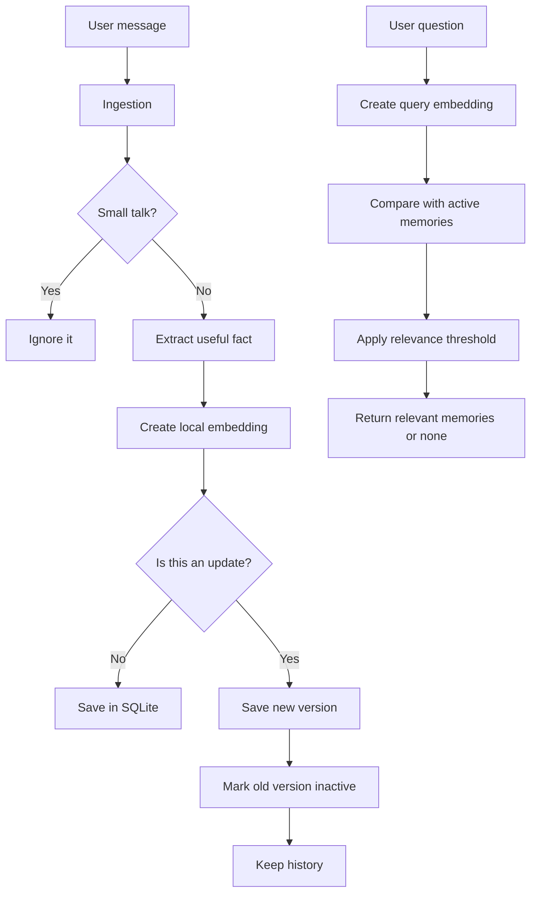

# Local Memory Engine for AI Chatbots

A small, local memory system for an AI chatbot.

It can:

- remember useful facts about a user;
- ignore messages such as `hello` and `ok thanks`;
- update a memory when the user gives newer information;
- keep the old version for history;
- find relevant memories later; and
- return nothing when the answer is not stored.

This project uses **Python**, **SQLite**, **Sentence Transformers**, and **FastAPI**. It runs on a normal laptop and does not need a paid API.

## The task in simple words

The chatbot should be able to understand a conversation like this:

```text
I use Arch Linux.
I'm building a Next.js app.
My project deadline is October 15.
Actually, the deadline moved to November 2.
```

Then it should answer:

```text
What OS does the user use?
→ User uses Arch Linux.

When is the project deadline?
→ User's project deadline is November 2.

What is the user's favourite food?
→ No relevant memory.
```

## Main idea



## What is required and what is extra?

### Required by the recruitment task

- Save useful memories.
- Ignore small talk.
- Store the memory type, source message, and timestamps.
- Handle changed or contradictory information.
- Keep old versions instead of silently deleting them.
- Retrieve memories using local embeddings.
- Return no memories for an unrelated question.
- Persist data after restarting the program.
- Provide these API endpoints:
  - `POST /memory`
  - `POST /recall`
  - `GET /memories`
  - `DELETE /memory/{id}`
- Create at least 30 evaluation cases.
- Explain the design in the README and video.
- Commit the project progressively to GitHub.
- State where AI coding assistants were used.

### Small extras included

I included a few simple extras:

- BM25 keyword search alongside semantic search.
- Importance scores.
- A small browser UI so the project is easier to demonstrate.

I did **not** add the other optional features such as Docker, latency benchmarks, duplicate merging, or Ollama. The priority was a small core system that is understandable and tested.

## Project structure

```text
local-memory-engine/
├── README.md
├── requirements.txt
├── memory_engine/
│   ├── models.py
│   ├── engine.py
│   ├── storage/
│   │   ├── db.py
│   │   └── repository.py
│   ├── ingestion/
│   │   ├── extractor.py
│   │   └── contradiction.py
│   └── retrieval/
│       ├── embedder.py
│       ├── search.py
│       └── hybrid_search.py
├── api/
│   ├── app.py
│   └── static/
│       └── index.html
├── evaluation/
│   ├── dataset.py
│   └── evaluate.py
└── tests/
    ├── test_storage.py
    ├── test_retrieval.py
    ├── test_hybrid_search.py
    ├── test_ingestion.py
    └── test_api.py
```

## How to run on Windows

Open **PowerShell** in the project folder.

### 1. Create the virtual environment

```powershell
py -3 -m venv .venv
.\.venv\Scripts\Activate.ps1
```

If activation is blocked:

```powershell
Set-ExecutionPolicy -Scope CurrentUser RemoteSigned
```

Then activate again:

```powershell
.\.venv\Scripts\Activate.ps1
```

### 2. Install dependencies

```powershell
python -m pip install --upgrade pip
pip install -r requirements.txt
```

The first embedding run may download `all-MiniLM-L6-v2`. That model is then used locally.

### 3. Run the tests

```powershell
python -m pytest -q
```

### 4. Run the evaluation

```powershell
python evaluation\evaluate.py
```

### 5. Start the application

```powershell
python -m uvicorn api.app:app --reload
```

Open the simple UI:

```text
http://127.0.0.1:8000
```

FastAPI's automatic documentation is also available here:

```text
http://127.0.0.1:8000/docs
```

Stop the server with `Ctrl+C`.

## How the important parts work

### 1. Ingestion

The ingestion code decides whether a message should become a memory.

Example:

```text
I prefer PostgreSQL.
→ User prefers PostgreSQL.
→ type: preference
```

The current extractor uses simple rules because they are easy to understand and test.

It recognizes memory types such as:

- `fact`
- `preference`
- `project`
- `event`
- `goal`

Small talk is ignored:

```text
hello
ok thanks
cool
sounds good
```

### 2. Storage

SQLite stores each memory with:

- memory ID;
- text;
- memory type;
- importance;
- original message;
- creation and update time;
- active/inactive status; and
- replacement links.

SQLite WAL mode is enabled. Embeddings are stored as compact NumPy `float32` BLOBs.

I chose SQLite because it is local, persistent, simple to set up, and does not need another database server.

### 3. Retrieval

The project uses the local model:

```text
all-MiniLM-L6-v2
```

It creates a 384-dimensional embedding for a memory and for a query. Similar meanings should have similar vectors.

The search uses:

- dense semantic similarity;
- BM25 keyword matching; and
- a relevance threshold.

The threshold matters because a vector search can always find the *closest* memory, even if every memory is unrelated. If the score is too low, the result is removed and the API returns:

```json
{"memories": []}
```

### 4. Updates

Suppose the database contains:

```text
User's project deadline is October 15.
```

Then the user says:

```text
Actually, the deadline moved to November 2.
```

The engine:

1. saves the November 2 memory;
2. marks the October 15 memory inactive;
3. links the old memory to the new one; and
4. keeps the old row for history.

So the latest memory is used for recall, but the old information is not silently lost.

## API examples

### Add a memory

`POST /memory`

```json
{
  "message": "I prefer PostgreSQL."
}
```

Possible response:

```json
{
  "status": "stored",
  "message": "Memory stored successfully.",
  "memory": {
    "text": "User prefers PostgreSQL.",
    "type": "preference",
    "importance": 0.8,
    "is_active": true
  },
  "replaced_memory": null
}
```

### Recall a memory

`POST /recall`

```json
{
  "query": "What database does the user prefer?",
  "top_k": 5,
  "threshold": 0.45
}
```

Possible response:

```json
{
  "memories": [
    {
      "text": "User prefers PostgreSQL.",
      "type": "preference",
      "score": 0.91
    }
  ]
}
```

### List memories

Active memories:

```text
GET /memories?active_only=true
```

All memories, including replaced history:

```text
GET /memories?active_only=false
```

### Delete a memory

```text
DELETE /memory/{id}
```

## Evaluation

The recruitment task asks for at least 30 cases. The evaluation dataset covers:

- direct facts;
- preferences;
- projects;
- events;
- goals and deadlines;
- changed information;
- several memories in one query;
- small-talk messages; and
- questions where the answer is not stored.

Run it with:

```powershell
python evaluation\evaluate.py
```

Fill in the real results before submitting:

| Result | Value |
|---|---:|
| Number of cases | **31** |
| Passed cases | **31** |
| Accuracy | **100%** |
| Unknown questions returning no result | **4/4** |

I will not claim 100% accuracy unless the program actually produces it.

Run all tests with:

```powershell
python -m pytest -q
```

The tests check storage, embeddings, search, small-talk filtering, updates, and API responses.

## Challenges faced and how I solved them

### Challenge 1: avoiding unrelated search results

Vector search can return the closest memory even when it is not actually relevant. I added a relevance threshold, so weak matches are removed and the API can return an empty list.

### Challenge 2: updating information without losing history

I did not want a new deadline to delete the old deadline. I solved this by keeping both rows in SQLite. The old row becomes inactive and points to the new row, while the new row points back to the old row.

### Challenge 3: keeping the project local

I wanted to avoid paid APIs and external services. I used a local Sentence Transformer for embeddings and SQLite for persistence. This keeps setup simple and works on a student laptop.

### Challenge 4: making the project easy to test

I separated storage, ingestion, retrieval, and API code. That allowed me to test each part separately instead of only testing the whole application at the end.

## Limitations

This is a student-sized project, so it has limits:

- The extractor uses rules and does not understand every sentence.
- Topic detection uses a small list of known words.
- Searching currently scans the active memories, which is fine for a small dataset.
- The UI is only a simple demo page, not a production application.

## If there were 10 million memories

The first problems would be memory usage and the time needed to scan every vector.

I would improve it with:

- an approximate-nearest-neighbor index such as HNSW or FAISS;
- vector compression or quantization;
- partitioning memories by user; and
- a persistent vector index.

## AI assistance disclosure

The recruitment task allows coding assistants as long as the developer reviews the code.

I used AI coding assistants to help with boilerplate, test ideas, explanations, and code review. I chose the project structure and main technical approach, ran the code and tests, checked the behavior, and reviewed the final implementation. I am responsible for the final code and can explain the main parts of the project.

## Git history

The project was developed in small commits instead of one giant final commit. The history shows the main stages:

```text
initialize SQLite storage
add local embeddings and basic search
add keyword search and hybrid ranking
add small-talk filtering and fact extraction
save extracted memories and handle updates
add REST API for memories and recall
add simple memory web page
add evaluation cases and result report
write project README and usage documentation
```
